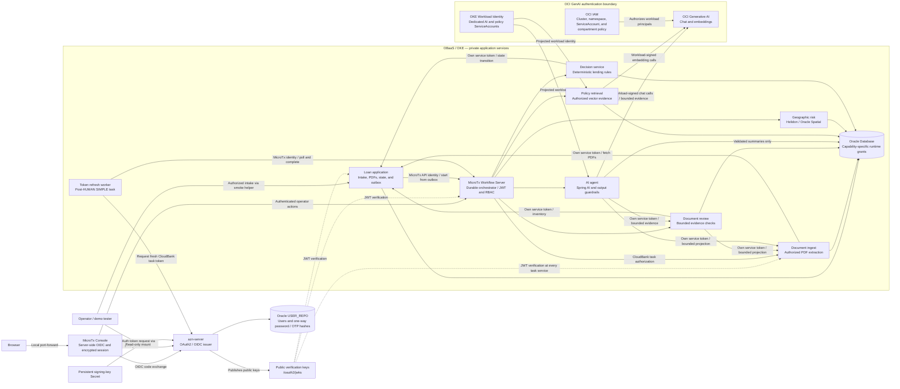
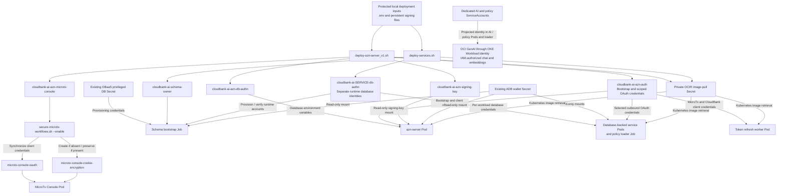
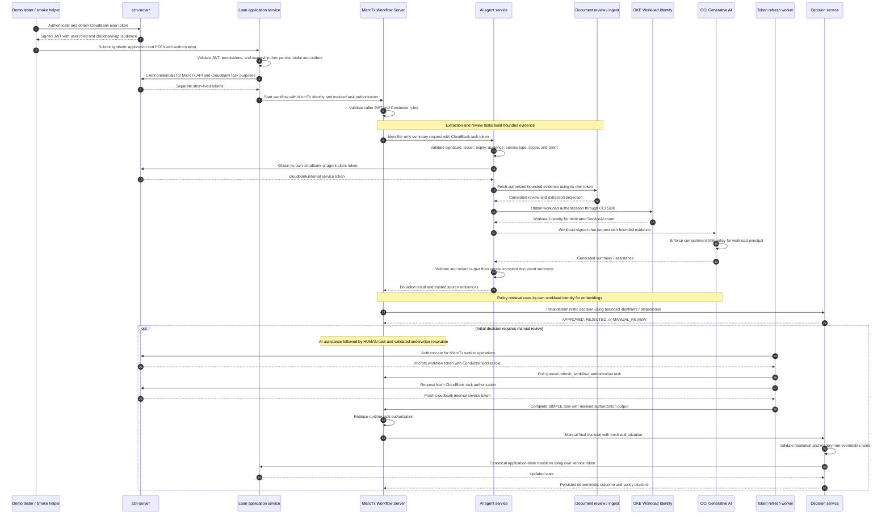
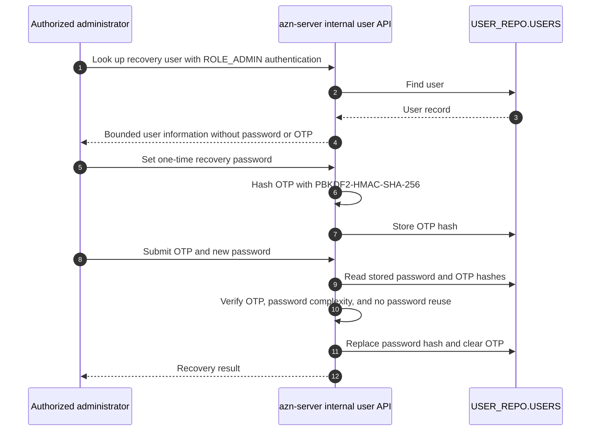

# CloudBank AI 2026.0

CloudBank AI is a reference application for retail personal loan origination built on **Oracle Backend for Microservices and AI (OBaaS)**. It brings Oracle Database, MicroTx Workflows, Spring Boot, Helidon, Spring AI, and OCI Generative AI together in a banking demonstration that uses synthetic customer documents and policies. The loan journey connects durable application intake, document processing, policy retrieval, geographic-risk evaluation, deterministic lending decisions, and human underwriting.

OBaaS provides the platform for deploying and operating these capabilities on Oracle Kubernetes Engine (OKE): Kubernetes and Helm deployment, Oracle Database integration, service discovery, configuration, secret integration, gateway capabilities, and observability. Within that platform, **MicroTx Workflows is the durable orchestration and governance layer**. It coordinates service calls, retries, evidence routing, and human tasks while preserving execution history and correlation across the loan journey.

The demonstration follows a clear division of responsibility. Services own business capabilities and their data; AI produces bounded assistance; underwriters resolve cases requiring human judgment; and the deterministic decision service owns lending outcomes. The loan application service owns application state and immutable uploaded PDFs. Document ingest retrieves authorized PDFs and persists structured extractions. Document review checks completeness and consistency through service APIs. Policy retrieval supplies bounded, authorized policy evidence, and geographic risk evaluates location signals using Oracle Spatial and Autonomous Database geocoding. The workflow exchanges identifiers, dispositions, and bounded evidence rather than copying PDFs or raw extracted text between participants.

Spring AI connects the AI agent service to OCI Generative AI for guarded document summaries and manual-review assistance. Policy evidence support is deterministic and preserves policy references for grounding and traceability. Validated document summaries are persisted in a dedicated Oracle result store. AI assistance cannot approve or reject loans, override policy, update application state, or bypass human review. OCI calls use **OKE Workload Identity**, with separate Kubernetes ServiceAccounts and IAM permissions for chat and embeddings.

### What the demonstration shows

- **Durable orchestration:** a transactional workflow-start outbox, bounded extraction and review remediation, technical retries, idempotent service operations, and explicit handling of exceptional outcomes.
- **Evidence-based processing:** document-review results, versioned policy citations, and geographic-risk signals feed deterministic decision rules.
- **Human underwriting:** `MANUAL_REVIEW` decisions pause at a HUMAN task; completion supplies a structured resolution that is validated before final decisioning.
- **Long-running authorization:** a MicroTx worker refreshes task authorization after human review so delayed workflows can resume with a fresh service token.
- **Governed AI:** authorized, bounded evidence and output validation constrain model participation; unavailable assistance has explicit fallback paths.
- **Security and observability:** centralized OAuth2/OIDC, persistent JWT signing keys, endpoint-specific authorization, least-privilege database accounts, OKE Workload Identity, and correlated OpenTelemetry instrumentation.

### Main technologies

| Technology | Role in CloudBank AI |
| --- | --- |
| Oracle Backend for Microservices and AI | Platform deployment, operations, database integration, service discovery, configuration, gateway capabilities, and observability. |
| OKE, Kubernetes, Helm, and OCIR | Container execution, application releases, workload identities, and private image publication. |
| MicroTx Workflows | Durable orchestration of service tasks, retries, branching, human review, and post-review token refresh. |
| Java 25, Spring Boot, and Helidon | Capability-aligned microservices; geographic risk uses Helidon. |
| Spring Security and Spring Authorization Server | OAuth2/OIDC, JWT issuance and validation, roles, scopes, and client identities. |
| Oracle Database / Autonomous Database | Relational facts, PDF BLOBs, structured JSON extraction, policy vectors, spatial data, and durable service results. |
| Oracle Spatial and GCDR | Geographic-risk evaluation and address geocoding when stored coordinates are unavailable. |
| Spring AI and OCI Generative AI | Guarded chat-model assistance and policy embeddings for vector retrieval. |
| Apache PDFBox, Liquibase, and Oracle UCP | Deterministic PDF extraction, versioned schema migrations, and database connection pooling. |
| OpenTelemetry and OBaaS observability | Correlated service telemetry and operational inspection. |

## 📦 Installation Guide

For complete installation instructions, see **[cloudbank-v6-install.md](./deploy/obaas/cloudbank-v6-install.md)**.

The guide covers:

- Installing OBaaS on OKE and selecting the application namespace.
- Deploying `azn-server` with persistent signing keys and Oracle-backed users.
- Securing the MicroTx Console, Workflow Server, and transaction coordinator with CloudBank authentication.
- Building and publishing private application images, provisioning service database identities, and deploying the CloudBank services with Helm.
- Authorizing OCI GenAI chat and embedding calls through OKE Workload Identity.
- Loading the synthetic policy corpus and deploying `cloudbank-loan-origination` version 1.
- Deploy the BFF using its [runbook](./deploy/obaas/gateway-bff-runbook.md).
- Accessing the environment.

## 🧪 Testing Guide

The workflow tests use the OKE environment described in [cloudbank-v6-install.md](./deploy/obaas/cloudbank-v6-install.md). Complete installation, MicroTx authentication, the OCI IAM policies, policy loading, workflow publication, and the GCDR access grant before running them. Run scripts from the repository root. These tests create durable synthetic applications and uploaded documents for inspection.

### Setup the access routes for the OBaaS OKE environment
- Open the five port-forward needed to access the services. 
    - On Linux/MacOSx:
    ```
    ./port-forward-services.sh <CLOUDBANKAI_NAMESPACE>
    ```
    - On MS Windows: 
    ```
    powershell.exe -NoProfile -ExecutionPolicy Bypass -File .\port-forward-services.ps1 <CLOUDBANKAI_NAMESPACE>
    ```
- Connect to **MicroTx Web Console**:

	- Open an incognito browser on: http://localhost:5002/consoleui/

	- Provide `obaas-admin`/**<AZN_BOOTSTRAP_USERS_ADMIN_PASSWORD>** you'll find in `.env` file.


### Web GUI Test - live Backend For Front-end (BFF)

This test is possible only if you have successfully deployed the BFF using its [runbook](./deploy/obaas/gateway-bff-runbook.md).
Check if are running the following tunnel to OBaaS, provided by the previously started `port-forward-services.sh` script:

```bash
# Terminal 1: authorization server
kubectl --context "$KUBE_CONTEXT" --namespace "$MICROTX_NAMESPACE" \
  port-forward --address 127.0.0.1 service/azn-server 8080:8080
```
and 
```bash
# Terminal 2: BFF
kubectl --context "$KUBE_CONTEXT" --namespace "$MICROTX_NAMESPACE" \
  port-forward --address 127.0.0.1 service/gateway-bff-service 8089:8089
```

If you want to test the GUI with the actual services implemented run:

- install node 22.x+ of not yet done:

```bash
# Terminal 3: Web GUI
cd cloudbank-v6/src/cloudbank_ui

nvm install 22
nvm alias default 22
nvm use 22
```
- run the WebGUI

```bash
npm ci --include=dev && npm run dev
```

- To explore the full mock workspace instead, look at running:

```bash
# Terminal 3: Web GUI
cd src/cloudbank_ui && npm ci --include=dev && VITE_DATA_MODE=mock npm run dev
```

Open `http://127.0.0.1:5173`, select **Sign in with CloudBank**, authenticate
as `obaas-admin`, and open **Applications**. The list and status filter use
the running loan service through the BFF. Creation, PDF upload, explicit start,
and HUMAN task completion are available in live mode. 


HUMAN completion requires `cloudbank.write` and the explicit `ROLE_UNDERWRITER`
grant. The current authorization-server demo already bootstrap grants the UNDERWRITER
role to `obaas-admin`.

#### Create an application, upload PDFs, and start processing

1. Select **New application**. The form is prefilled with the geocoded smoke-test
   values: a synthetic applicant, USD 5,000, 24 months, and two required document
   rows, **LOAN_APPLICATION** and **PAY_STATEMENT**. Keep these defaults for this test.
2. Use the ready packet in
   [`synthetic_data/customer_packets/demo_geocoded_loan`](synthetic_data/customer_packets/demo_geocoded_loan/README.md).
   Its `application.json` supplies the GUI defaults and the CLI intake template.
   Both PDFs are already available, contain no runtime application ID, and can
   be selected before creating the application:

   | Document row | File, relative to the repository root |
   | --- | --- |
   | **LOAN_APPLICATION** | [`synthetic_data/customer_packets/demo_geocoded_loan/loan_application.pdf`](synthetic_data/customer_packets/demo_geocoded_loan/loan_application.pdf) |
   | **PAY_STATEMENT** | [`synthetic_data/customer_packets/demo_geocoded_loan/pay_statement_novereign_systems.pdf`](synthetic_data/customer_packets/demo_geocoded_loan/pay_statement_novereign_systems.pdf) |

3. Select **Create application →**. The backend assigns application/document IDs,
   saves metadata, and leaves processing deferred. Keep the upload page open;
   the GUI binds the selected files to the returned document IDs. Files can also
   be selected on this page. No command or PDF regeneration is required.
4. Press **Upload** on **each** row. Wait until both show **received** and the
   stored byte count. Choosing a file prepares it for upload; the **Upload** action
   stores its contents in the loan service. Starting with metadata only causes
   document extraction to fail.
5. Select **Start processing →**. After the start request is accepted, return to
   **Applications** and press **Refresh** to see the assigned workflow ID and
   current application status. Processing is asynchronous; start acceptance does
   not mean that the workflow has completed or the loan has been approved.

Complete creation, upload, and start on the same page. Reopening an unfinished
intake after navigation or a browser reload is outside this GUI increment.

Application association is established by intake/upload metadata and
workflow request context, never by an identifier searched for in PDF text.

### Start the same packet from the command line

As an alternative to creating and starting an application in the GUI, run this
command from the repository root, with `KUBE_CONTEXT` and `MICROTX_NAMESPACE`
set for your deployment:

```bash
export KUBE_CONTEXT="$(kubectl config current-context)"
export MICROTX_NAMESPACE='<CLOUDBANKAI_NAMESPACE>'

./src/workflows/start-geocoded-loan-oke.sh "$KUBE_CONTEXT" \
  --namespace "$MICROTX_NAMESPACE" \
  --application-file synthetic_data/customer_packets/demo_geocoded_loan/application.json
```

The script creates a new application from `application.json`, uploads the two
ready PDFs, starts its workflow, and verifies the geographic-risk evidence.
Each invocation creates a separate application. See
[Smoke test to start MicroTx Workflow](#smoke-test-to-start-microtx-workflow)
for prerequisites and execution details. In the GUI, refresh **Applications**
to follow the new application and use **Manual review** if a HUMAN task is pending.

#### Approve a HUMAN review task

1. Since the workflow requires in this test case a human review, open **Workflow Notification** from **MicroTx Workflows Console**: http://localhost:5002/consoleui
2. Click the task for your application. Check its application/workflow IDs and review reason. The detail form shows the completion fields and safe evidence reference IDs. Do not approve from this interface because you need to add extra input not possible by the console interface.
3. Open **Executions** from **MicroTx Workflows Console**, and copy the `Workflow ID` of your running application.
4. Complete it with the helper script:

   ```bash
   export WORKFLOW_ID='<workflow-id-from-console>'

   ./src/workflows/cloudbank-loan-origination/complete-manual-review.sh \
   "$WORKFLOW_ID" \
   --outcome APPROVED \
   --server-url "http://127.0.0.1:9010/workflow-server/api" \
   --from-env
   ```

   Review the helper's displayed plan and confirm the intended synthetic execution. It supplies the bounded underwriter resolution, checks the pending task, and waits for the terminal workflow status. The workflow validates the resolution, refreshes its CloudBank task authorization, and invokes the manual-final deterministic decision. An `APPROVED` human resolution remains subject to non-overridable lending rules.


## Security Architecture

CloudBank AI uses `azn-server` as its central OAuth2/OIDC issuer. Spring services validate CloudBank JWTs with Spring Security; the Helidon geographic-risk service uses MicroProfile JWT. Protected internal operations additionally check service-token type, scope, and an allow-listed client identity. Database access uses separate runtime accounts with grants limited to each capability.

The OKE deployment uses private `ClusterIP` Services. Operators access the environment through loopback-bound port-forwards, and browser login goes through the server-side MicroTx Console OIDC flow. OBaaS provides gateway capabilities; the CloudBank deployment helpers do not create public API routes. Service-side validation protects calls made directly inside the cluster as well as port-forwarded calls.



MicroTx invokes every protected HTTP task with CloudBank authorization; each task service validates the JWT independently. The JWKS arrows illustrate key distribution, not request-time delegation of authorization. The policy loader also uses the policy ServiceAccount for embedding calls during corpus initialization.

### Security Components

| Component | Security responsibility |
| --- | --- |
| `azn-server` | Authenticates users and OAuth clients, issues JWTs with explicit audience and token type, publishes issuer metadata/JWKS, and signs with persistent RSA keys. |
| MicroTx Console and Workflow Server | Keep the browser OIDC client secret and code exchange server-side, protect sessions, authenticate workflow operations, and enforce Conductor roles. |
| Spring resource servers | Validate signature, issuer, expiry, and `cloudbank-api` audience; enforce endpoint-specific scopes, roles, ownership, and client allow-lists. |
| Helidon geographic-risk service | Validate CloudBank JWTs and require an authorized internal service identity before spatial evaluation. |
| MicroTx loan-origination workflow | Coordinate bounded evidence, retries, and human review; mask task authorization fields and validate human completion before continuing. |
| Token refresh worker | Use separate MicroTx and CloudBank OAuth purposes; obtain fresh task authorization after human review. |
| AI agent service | Fetch evidence with its own OAuth identity, bound and redact model input, validate output, and persist only accepted document summaries. |
| OKE Workload Identity and OCI IAM | Authorize OCI chat and embedding calls using dedicated workload principals and compartment permissions. |
| Kubernetes Secrets | Supply database credentials, OAuth secrets, signing material, Console session protection, image-pull authentication, and ADB wallet mounts. |
| Oracle Database | Enforce runtime roles; retain source documents, typed facts, policy evidence, and durable results within their authorized service boundaries. |

### Secrets

Deployment helpers create or reuse application Secrets in the OBaaS application namespace. Protected local `.env` and signing-key files supply deployment inputs; Kubernetes injects only the required Secret keys into each workload. The schema bootstrap Job receives privileged provisioning credentials. Runtime services receive their own database identities, and the token refresh worker receives no database account or wallet.



| Secret or identity | Material / purpose | Consumers and lifecycle |
| --- | --- | --- |
| Existing OBaaS privileged DB Secret | Database provisioning identity and service alias. | Bootstrap only; discovered from the installed platform. |
| Existing ADB wallet Secret | Oracle connection wallet. | Read-only mounts in database-backed workloads and bootstrap; absent from the token refresh worker. |
| `cloudbank-ai-schema-owner` | `CLOUDBANK` schema-owner password. | Schema bootstrap; created when missing and preserved on subsequent deployments. |
| `cloudbank-ai-azn-db-authn` | `USER_REPO` database connection identity. | Authorization server runtime. |
| `cloudbank-ai-<service>-db-authn` | Separate runtime database credentials, including a dedicated policy-loader identity. | Each database-backed workload receives its own Secret; existing credentials are preserved. |
| `cloudbank-ai-azn-auth` | Bootstrap user passwords and client-specific OAuth secrets. | Authorization-server client registration and selected outbound service credentials; Pods receive only the keys they need. |
| `cloudbank-ai-azn-signing-key` | Persistent RSA private/public key files and key identifier. | Read-only authorization-server mount; retained across ordinary redeployments. Key rotation is deliberate because it affects token verification. |
| `cloudbank-ai-azn-microtx-console` and `microtx-console-oauth` | Console OIDC client registration and synchronized credentials. | Authorization server and MicroTx Console; synchronized by the security helper. |
| `microtx-console-cookie-encryption` | Console session encryption secret. | Created if absent and preserved when authentication is reapplied. |
| Configured OCIR image-pull Secret | Private registry authentication. | Kubernetes image pulls; refreshed from protected deployment inputs on deployment. |
| AI and policy Kubernetes ServiceAccounts | Workload principals for OCI GenAI. | OKE Workload Identity and IAM; the OKE deployment does not distribute OCI API keys or user private-key files to these Pods. |

Workflow definitions contain no client secrets, database credentials, wallet material, or PDFs. Protected HTTP tasks use the short-lived `workflowTaskAuthorization` runtime value. The workflow declares `workflowTaskAuthorization` and `Authorization` as masked fields; that value remains sensitive workflow state and access to execution APIs, history, logs, and the Console must be controlled. Service tokens are not included in business responses or model evidence. The refresh worker obtains a fresh task token after the manual-review HUMAN task.

### Authentication And Authorization

CloudBank service calls and OCI GenAI calls use distinct identities. `azn-server` signs application JWTs; OKE supplies the workload identity used by the OCI SDK. An application bearer token is not an OCI credential.



The diagram focuses on the authorization boundaries; policy retrieval, geographic evaluation, and other workflow steps follow the same protected task-call pattern. Services performing outbound calls acquire their own service token instead of forwarding the inbound workflow token.

| OAuth client | Audience and scopes | Purpose |
| --- | --- | --- |
| `cloudbank-client` | `cloudbank-api`; configured user scopes including `openid`, `cloudbank.read`, and `cloudbank.write`. | Synthetic user authentication and authorized application operations in the smoke helpers. |
| `cloudbank-service-client` | `cloudbank-api`; `cloudbank.internal`. | Workflow HTTP-task authorization and shared internal service operations, including decision-service outbound state transitions. |
| `cloudbank-document-ingest-client` | `cloudbank-api`; `cloudbank.internal`. | Authorized retrieval of loan-owned document content. |
| `cloudbank-document-review-client` | `cloudbank-api`; `cloudbank.internal`. | Inventory and bounded extraction reads for deterministic review. |
| `cloudbank-ai-agent-client` | `cloudbank-api`; `cloudbank.internal`. | Review and bounded extraction reads for governed AI; excludes PDF retrieval and extraction initiation. |
| `cloudbank-test-client` | `cloudbank-api`; `cloudbank.test`. | Scoped test operations. |
| `cloudbank-admin-client` | `cloudbank-api`; `cloudbank.admin`. | Scoped administrative operations. |
| `microtx-workflow-client` | `microtx-workflow`; `microtx.workflow`; Conductor user/worker roles. | Workflow API operations and task polling/completion. |
| `microtx-console-client` | `cloudbank-api`; `openid`, `cloudbank.read`, and `cloudbank.write`; authenticated user roles. | Server-side Console authorization-code flow and session management. |

For CloudBank internal endpoints, `cloudbank.internal` alone is insufficient: the JWT must also have `token_kind=service` and an accepted `client_id`. Spring maps scopes to `SCOPE_...` authorities, while the Helidon service reads the JWT scope claim. User operations enforce endpoint permissions and application ownership; operator and underwriter actions use the relevant role checks. MicroTx maps authenticated roles to its administrative, metadata, user, read-only, and worker permissions.

The browser receives the Console session established through OIDC. The Console keeps the confidential client secret and authorization-code exchange on the server, with encrypted session-cookie handling. Its login flow does not use the internal user-management API.

### Forgot Password Flow

Password recovery is an administrator-assisted operation on the internal authorization-server user API. It requires `ROLE_ADMIN` and is not a public browser endpoint. Passwords and one-time passwords are stored as PBKDF2-HMAC-SHA-256 hashes; the API does not return either value.



## Project Structure

The root Maven build contains eleven modules: nine runtime services, the policy loader, and the shared embedding library.

```text
cloudbank-ai/
├── README_public.md                    # Public application guide
├── pom.xml                             # Java 25 multi-module Maven build
├── Dockerfile                          # Service, policy-loader, and schema-init image targets
├── compose.yaml                        # Local development stack
├── run-compose.sh                      # Local lifecycle and component verification
├── src/
│   ├── azn-server/                     # OAuth2/OIDC, users, roles, and JWT signing
│   ├── gateway-bff-service/            # Browser session and authorized application list (A/B)
│   ├── loan-application-service/       # Intake, immutable PDFs, state, and workflow-start outbox
│   ├── document-ingest/                # PDF extraction and structured result persistence
│   ├── document-review-service/        # Deterministic document and evidence review
│   ├── decision-service/               # Deterministic decisions and policy citations
│   ├── ai-agent-service/               # Spring AI / OCI summaries and underwriting assistance
│   ├── geographic-risk-service/        # Helidon / Oracle Spatial and GCDR evaluation
│   ├── policy-retrieval-service/       # Authorized, bounded vector-backed policy retrieval
│   ├── policy-embedding-support/       # Shared OCI embedding and authentication library
│   ├── policy-loader/                  # Synthetic policy corpus and embedding loader
│   ├── workflow-token-refresh-worker/  # Post-human-review authorization refresh
│   ├── workflows/
│   │   ├── cloudbank-loan-origination/ # Versioned definitions, task definitions, and helpers
│   │   ├── start-geocoded-loan-oke.sh  # Geocoded OKE workflow smoke test
│   │   └── geocoded-loan-address.json # Synthetic address fixture
│   └── schema/
│       ├── changes/                    # Ordered schema migrations and runtime grants
│       ├── admin/                      # Privileged provisioning SQL
│       ├── sql/                        # Database feature SQL
│       ├── seeds/                      # Synthetic JSON fixtures and loaders
│       └── verify/                     # Schema and feature validation
├── deploy/
│   ├── obaas/
│   │   ├── cloudbank-v6-install.md     # OKE installation and testing guide
│   │   ├── azn-server-runbook.md       # Authorization-server deployment procedure
│   │   ├── services-runbook.md         # Services, schema, policies, and Workload Identity
│   │   ├── deploy-azn-server_v1.sh     # Authorization-server publication and deployment
│   │   ├── gateway-bff-runbook.md      # BFF-only OKE deployment and local port-forward
│   │   ├── deploy-gateway-bff.sh       # Repeatable BFF-only Helm deployment
│   │   └── deploy-services.sh          # Application image publication and Helm deployment
│   └── microtx/
│       ├── oke-obaas/                  # MicroTx authentication integration on OBaaS
│       └── minikube/                   # Local Kubernetes MicroTx integration
├── synthetic_data/
│   ├── customer_packets/              # Clearly synthetic PDF packets for demos and tests
│   └── policy/                        # Versioned synthetic underwriting policy corpus
├── media/                             # Application illustrations
└── output/                            # Generated run artifacts
```

Service-specific setup, API contracts, and component checks are documented in each service's README. The [loan-origination workflow guide](src/workflows/cloudbank-loan-origination/README.md) describes workflow publication, task behavior, and the structured manual-review completion contract.
