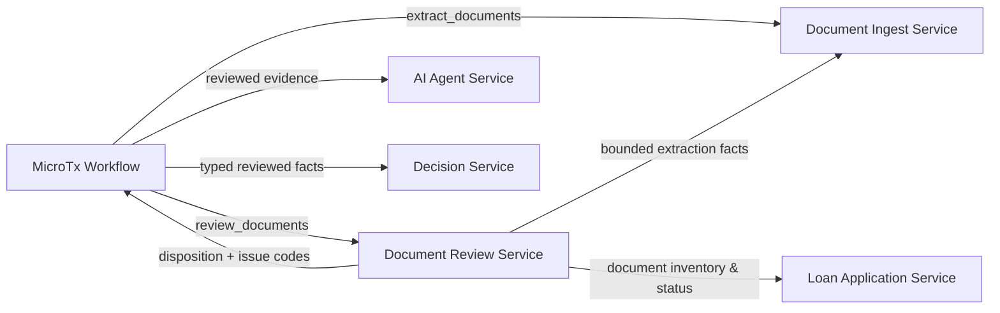

# CloudBank Document Review Service

`document-review-service` is the deterministic evidence-quality gate in the
CloudBank loan-origination demo. It runs after document extraction and before
downstream evidence processing. Its job is to answer one narrow question:

> Is the submitted document packet complete, extractable, and internally
> consistent enough for the loan workflow to continue?

It is not a credit-decision service. A `BLOCKED` result means document
processing cannot safely proceed; it never approves or rejects a loan.

The service listens on port `8084` and exposes internal, service-to-service
endpoints only.

**Implementation status:** the service, schema migrations, internal endpoints,
and sequential `review_documents` workflow task are present. The exact MicroTx
branching and retry syntax for each disposition must still be verified against
the deployed MicroTx/Conductor version before treating the full workflow route
as release-ready.

## Where It Fits



The workflow passes only correlation metadata to this service. The service
then obtains the two inputs it needs using its own credentials:

| Input | Source | What it uses |
| --- | --- | --- |
| Document manifest | Loan Application Service | Document ID, type, required flag, and processing status |
| Review projection | Document Ingest Service | Extraction status, provider/model, confidence, selected facts, warnings, and validation signals |

The service never retrieves PDF bytes, raw document text, full extraction JSON,
customer tokens, or browser credentials.

## What It Does

For each request, the service:

1. Validates the caller, request body, and idempotency key.
2. Fetches the current document manifest and bounded extraction-review input.
3. Evaluates the versioned `document-review-v2` deterministic rule profile.
4. Persists an idempotent review record, issue projections, and selected
   numeric evidence in Oracle Database.
5. Acknowledges document-level status changes back to Loan Application Service.
6. Returns one compact workflow disposition and stable issue codes.

The review profile is intentionally deterministic. Spring AI and other models
may later summarize already-reviewed evidence or assist a human reviewer, but
they do not influence this service's disposition.

## Outcomes

| Disposition | Meaning | Workflow implication |
| --- | --- | --- |
| `CLEAR` | Required evidence is present, extracted, and passes the current checks. | Continue to later evidence, policy, and risk tasks. |
| `MANUAL_REVIEW` | Evidence needs human inspection, for example low confidence or an income inconsistency. | Create or defer to a human-review path; this is not a lending outcome. |
| `RETRY_EXTRACTION` | A required extraction is absent or retryably failed. | Retry the extraction path within its configured workflow retry policy. |
| `BLOCKED` | A required document is missing, extraction failed finally, or evidence is unsafe to process. | Stop document processing and route for remediation. This is not a loan rejection. |

If several issues apply, the most restrictive disposition wins:
`BLOCKED` → `RETRY_EXTRACTION` → `MANUAL_REVIEW` → `CLEAR`.

## Current Rule Profile

`document-review-v2` records stable issue codes for the following checks:

- unsupported document type;
- a required document that is still expected or otherwise unavailable;
- a missing required extraction;
- retryable and final extraction failures;
- low or missing statistical extraction confidence;
- an `income_clarification_required` warning or validation signal;
- more than 10 percent variance between stated, pay-document, and verified
  monthly income;
- inconsistent employer names across documents; and
- inconsistent identity outcomes across documents.

Application IDs are intake metadata. Version 2 never requires, compares or
trusts an application ID extracted from PDF text. Request, loan-manifest and
ingest-envelope application IDs must agree, or review fails with a safe `502`.
Document ownership, missing-document/extraction checks, confidence and business
consistency checks remain active. Existing persisted v1 reviews are readable
and identical retries return their original result; they are not silently re-evaluated.

Rules, thresholds, and issue codes are implemented in
[`DocumentReviewV2Profile.java`](src/main/java/com/cloudbank/documentreview/rules/DocumentReviewV2Profile.java).
Changing them should create a new profile version rather than silently changing
the meaning of previously persisted reviews.

## API Contract

All endpoints are internal. Callers need a JWT whose client ID is in
`DOCUMENT_REVIEW_CALLER_CLIENT_IDS` (by default,
`cloudbank-service-client`). Browser clients must not call this service
directly.

### Start or retry a review

```http
POST /internal/api/v1/document-reviews
Authorization: Bearer <service-token>
Idempotency-Key: WF-APP-MR-002:review_documents
Content-Type: application/json
```

```json
{
  "applicationId": "APP-MR-002",
  "workflowId": "WF-APP-MR-002",
  "taskReference": "review_documents",
  "traceId": "0123456789abcdef0123456789abcdef"
}
```

`Idempotency-Key` is required and must be 8–200 characters from
`A-Za-z0-9._:-`. Reusing a key with the same request returns the stored review
or resumes a pending document-status acknowledgement. Reusing it with a
different request returns `409 IDEMPOTENCY_KEY_CONFLICT`.

A typical response is:

```json
{
  "reviewId": "DREV-7dbcb35b759b4d34a92815d97e89e8f1",
  "applicationId": "APP-MR-002",
  "workflowId": "WF-APP-MR-002",
  "taskReference": "review_documents",
  "reviewStatus": "COMPLETED",
  "disposition": "MANUAL_REVIEW",
  "profileVersion": "document-review-v2",
  "documentCounts": {
    "total": 3,
    "validated": 1,
    "needsReview": 2,
    "retryRequired": 0,
    "blocked": 0
  },
  "issues": [
    {
      "issueCode": "INCOME_DIFFERENCE_OVER_10_PERCENT",
      "severity": "REVIEW",
      "routingEffect": "MANUAL_REVIEW",
      "documentIds": ["DOC-MR-006", "DOC-MR-007"],
      "message": "Verified income differs from submitted evidence by more than 10 percent."
    }
  ],
  "traceId": "0123456789abcdef0123456789abcdef",
  "acknowledgements": [
    {
      "documentId": "DOC-MR-006",
      "targetStatus": "NEEDS_REVIEW"
    }
  ]
}
```

### Retrieve an existing review

```text
GET /internal/api/v1/document-reviews/{reviewId}
GET /internal/api/v1/applications/{applicationId}/document-reviews/latest
```

Both return the same review-result shape. An unknown review returns
`404 DOCUMENT_REVIEW_NOT_FOUND`.

### Operational endpoint

```text
GET /actuator/health
```

This endpoint is unauthenticated so deployment tooling can check readiness. It
does not expose review data.

## Status Acknowledgements

After persisting a review, the service updates the status of documents that
were already `EXTRACTED`:

| Review result | Document status written back |
| --- | --- |
| `CLEAR` | `VALIDATED` |
| `MANUAL_REVIEW` or `BLOCKED` | `NEEDS_REVIEW` |
| `RETRY_EXTRACTION` | `FAILED_RETRYABLE` |

The service does **not** change the loan application's status. MicroTx and the
later human-review or decision stages own application-level routing.

## MicroTx Orchestration and Client Boundary

MicroTx can take over the cross-service orchestration represented by the
service's Java clients, but it is not an in-process replacement for an HTTP
client. It moves an HTTP call, its retry policy, and its audit trail into the
workflow definition.

The recommended design is a hybrid:

- MicroTx owns the loan-journey sequence, retries, compensation, human routing,
  document-status acknowledgement, and the choice of the next task.
- Document Review Service owns the deterministic rules, review ID and input
  fingerprint, idempotency protection, and durable review state.
- The review service continues to fetch the smallest current manifest and
  extraction projection it needs, rather than putting financial evidence into
  workflow state.

### Why the Service Still Has Clients

| Current call | Can MicroTx own it? | Recommended direction |
| --- | --- | --- |
| Get the document manifest from Loan Application Service | Yes | Keep as an on-demand read for now. |
| Get the bounded extraction-review projection from Document Ingest Service | Yes | Keep as an on-demand read for now. |
| Transition document status in Loan Application Service | Yes | Move this to a MicroTx task first. |

Moving the two read calls into MicroTx would require the workflow to retain the
manifest and extraction projection in task output or workflow variables. Those
payloads include controlled customer and income evidence, so workflow history,
task inspection, telemetry, retention, and masking would all become part of
the data-governance boundary. There is also a stale-data risk between a fetch
task and the review task. The current identifier-only workflow input avoids
these concerns and fetches the minimum current data immediately before review.

### Recommended First Migration

Move document-status acknowledgement out of the review service first. The
future sequence should be:

```text
MicroTx → review endpoint
review service → manifest + extraction-review input → persist ACK_PENDING result
MicroTx → one or more loan-service status-transition tasks
MicroTx → mark acknowledgement complete
MicroTx → branch by CLEAR, MANUAL_REVIEW, RETRY_EXTRACTION, or BLOCKED
```

This makes the status transition visible as a first-class workflow step and
lets MicroTx own its retry, compensation, audit, and branching behavior. The
review service must expose an internal, idempotent completion callback that
marks a review complete only after every expected transition has succeeded.

### Before Removing Any Client

- Verify the deployed MicroTx/Conductor version supports the required dynamic
  task/loop and `SWITCH` syntax.
- Configure scoped OAuth credentials in the workflow runtime; do not put a
  reusable raw token in workflow input.
- Prove idempotency across the review request and every status transition.
- Define retry and compensation behavior for a partial acknowledgement.
- If evidence enters workflow state, validate masking, retention, access
  control, and telemetry handling for it.
- Add end-to-end tests for every disposition and a workflow restart.

## Persistence and Security

The service uses the least-privilege `CB_DOCUMENT_REVIEW_APP` Oracle account.
It persists the durable review in `CB_DOCUMENT_REVIEW` and records bounded
issue and evidence projections in existing review-oriented tables. Oracle
application context is set for the service identity before database access.

For outbound calls, the service obtains a client-credentials token as
`cloudbank-document-review-client`. It uses that token to call the loan and
ingest services. This keeps service credentials and raw tokens out of the
browser boundary.

## Run Locally

### Prerequisites

- Oracle schema migrations through `018-document-review-schema.sql` and
  `019-document-review-runtime-role.sql`;
- Authorization Server on `8080`;
- Loan Application Service on `8081`;
- Document Ingest Service on `8082`; and
- a configured review database password and OAuth client secret.

From this directory:

```bash
export DOCUMENT_REVIEW_DATASOURCE_PASSWORD='...'
export DOCUMENT_REVIEW_CLIENT_SECRET='...'
./run-locally.sh
```

Useful optional settings are:

| Variable | Default | Purpose |
| --- | --- | --- |
| `PORT` | `8084` | HTTP port |
| `DOCUMENT_REVIEW_DATASOURCE_URL` | Local Oracle Free PDB URL | Oracle connection |
| `DOCUMENT_REVIEW_DATASOURCE_USERNAME` | `CB_DOCUMENT_REVIEW_APP` | Runtime database account |
| `DOCUMENT_REVIEW_SCHEMA` | `CLOUDBANK` | Application schema owner |
| `DOCUMENT_REVIEW_CLIENT_ID` | `cloudbank-document-review-client` | Outbound OAuth client |
| `DOCUMENT_REVIEW_CALLER_CLIENT_IDS` | `cloudbank-service-client` | Comma-separated allowed inbound client IDs |
| `LOAN_APPLICATION_BASE_URL` | `http://127.0.0.1:8081` | Loan Application Service URL |
| `DOCUMENT_INGEST_BASE_URL` | `http://127.0.0.1:8082` | Document Ingest Service URL |
| `AZN_ISSUER_URI` | `http://127.0.0.1:8080` | JWT issuer |

For the normal local stack, use the repository root instead:

```bash
./run-compose.sh up
./run-compose.sh verify
```

`./smoke-test.sh` verifies the health endpoint and performs the signed-token
security integration check: it obtains a client-credentials token from
`azn-server`, verifies anonymous access is rejected, then calls a protected
unknown-review endpoint and requires `404`. That response proves the service
accepted the token's signature, issuer, audience, client identity, and internal
scope; an unauthorized caller would receive `401` or `403` instead. The smoke
test deliberately does not create a review, because that requires a durable
application and its corresponding extracted-document state.

## Development and Verification

```bash
mvn -f src/document-review-service/pom.xml test
```

The suite covers deterministic-rule boundaries and dispositions, internal
authorization and controller access, request validation, idempotency behavior,
document-status acknowledgement failure handling, and authenticated client
contracts. It also includes an Oracle Free Testcontainers integration test for
review persistence, projection semantics, and database identity-context
cleanup. Docker must be available to run that integration test.

## Related Documentation

- [Architecture boundary and workflow placement](../../docs/architecture/document-review-service.md)
- [Implementation plan and release gates](../../docs/architecture/document-review-service-implementation-plan.md)
- [Loan workflow definition](../workflows/cloudbank-loan-origination/workflow-v1.json)
- [Repository development guide](../../AGENTS.md)
