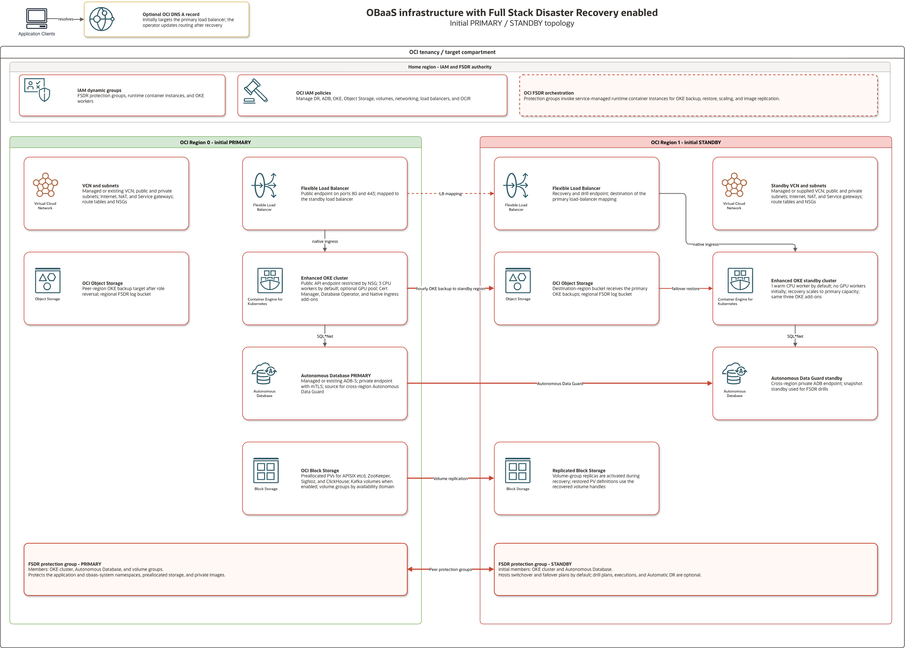

# OBaaS on Oracle Cloud Infrastructure

Oracle Backend for Microservices and AI (OBaaS) includes an [Infrastructure as Code (IaC)](https://github.com/oracle/microservices-backend/tree/main/opentofu) stack for deploying OBaaS in Oracle Cloud Infrastructure (OCI).

The stack provisions an enhanced Oracle Kubernetes Engine (OKE) cluster, worker nodes, networking, a flexible load balancer, and either an Autonomous Database or connectivity to an existing Oracle database.

It also includes configuration management scripts that can automatically install the OBaaS Helm charts. Kafka, Coherence, [AI Optimizer and Toolkit](https://github.com/oracle/ai-optimizer), GPU workers, and [Full Stack Disaster Recovery (FSDR)](#full-stack-disaster-recovery) are optional.

:::note[BYO Infrastructure]
If you are installing OBaaS into existing infrastructure, follow the [Helm installation guide](../helm/install.md).
:::

## Prerequisites

- An OCI tenancy, a target compartment, and the [IAM policies](#policies) below.
- Quota and regional capacity for OKE, CPU workers, a flexible load balancer, and any selected database, GPU, or disaster recovery resources. The default CPU pool has three workers with 2 OCPUs and 32 GB memory each.
- For an existing database, its privileged credentials and network connectivity from the OKE worker subnet. See the [database prerequisites](../helm/prereqs.md#oracle-database).
- For local deployment, OpenTofu or Terraform 1.5 or later, OCI CLI configured for API key authentication, Python 3, Helm, and `kubectl`. Configure OCI CLI for the same tenancy and user as the IaC provider.

## OCI Resource Manager

[OCI Resource Manager](https://docs.oracle.com/en-us/iaas/Content/ResourceManager/Concepts/resourcemanager.htm) automates the provisioning and management of OCI infrastructure using Terraform, enabling consistent, repeatable, and controlled deployments.

Select **Deploy to Oracle Cloud** to create a Resource Manager stack:

[](https://cloud.oracle.com/resourcemanager/stacks/create?zipUrl=https://github.com/oracle/microservices-backend/releases/latest/download/obaas-iac.zip)

### Create the Stack

1. Sign in to OCI and select the deployment region.
1. Review and accept the terms for the stack package.
1. Select the stack compartment and name, then continue to **Configure variables**.
1. Choose the resource compartment.
1. Enter an **Application Name** to identify the stack resources, or leave it blank to generate one.
1. Use [Configuration Options](#configuration-options) to configure Kubernetes, compute, database, network, load balancer, and optional services.
1. Run a **Plan** job and review the proposed changes.
1. Run an **Apply** job to deploy OBaaS.

## Local Deployment

Run the stack with OpenTofu or Terraform from a workstation or automation environment when you want to manage the configuration, plans, state, and execution directly. Local deployment provisions the same OCI infrastructure as Resource Manager and can automatically install the OBaaS Helm charts.

Choose the example closest to your deployment:

<table aria-label="OCI infrastructure examples">
  <thead>
    <tr><th scope="col">Example</th><th scope="col">Scenario</th></tr>
  </thead>
  <tbody>
    <tr><th scope="row"><code>k8s-new-adb.tfvars</code></th><td>OKE with a new Autonomous Database using a private endpoint.</td></tr>
    <tr><th scope="row"><code>k8s-byo-other-db.tfvars</code></th><td>OKE with an existing Oracle database.</td></tr>
    <tr><th scope="row"><code>k8s-fsdr.tfvars</code></th><td>OKE with Autonomous Database and cross-region disaster recovery.</td></tr>
  </tbody>
</table>

For example, start a new Autonomous Database deployment from a checkout of this repository:

```bash
cd opentofu
cp examples/k8s-new-adb.tfvars terraform.tfvars
```

Edit `terraform.tfvars` with your OCI identity, target compartment, region, and access ranges:

```hcl
tenancy_ocid     = "<tenancy-ocid>"
compartment_ocid = "<compartment-ocid>"
user_ocid        = "<user-ocid>"
fingerprint      = "<api-key-fingerprint>"
private_key_path = "/absolute/path/to/oci_api_key.pem"
region           = "<oci-region>"
label_prefix     = "obaasdev"

k8s_api_endpoint_allowed_cidrs = "<your-public-ip>/32"
client_allowed_cidrs           = "<client-network-cidr>"
server_allowed_cidrs           = "<client-network-cidr>"
k8s_use_local_charts           = true
```

Replace all example OCI and database values before deploying. Store credentials, state, saved plans, and `cfgmgt/stage/` in protected storage; staged manifests contain database credentials and private keys.

Review [Configuration Options](#configuration-options) before creating a plan.

### Prepare Helm Charts

For this checkout's OBaaS version, use its local charts. From `opentofu/`, prepare their dependencies:

```bash
helm dependency build ../helm/infra-charts/obaas-prereqs
helm dependency build ../helm/infra-charts/obaas
```

Keep `k8s_use_local_charts=true` when installing or testing these charts. For a published deployment, select a stack package or charts matching the intended OBaaS version. The remote chart version used by direct IaC runs is configured in `cfgmgt/apply.py`.

### Initialize, Plan, and Apply

```bash
terraform init
terraform validate
terraform plan -out=obaas.tfplan
```

Review the resource changes, then apply the saved plan:

```bash
terraform apply obaas.tfplan
```

The equivalent OpenTofu commands are also supported.

By default, `k8s_run_cfgmgt=true` runs `cfgmgt/apply.py` during apply. It applies the generated Kubernetes manifest, prepares the database operator, and installs `obaas-prereqs` in `obaas-system`, followed by `obaas` in the namespace returned by `app_name`. Reapplying reruns configuration management.

### Infrastructure-only Deployment

Set `k8s_run_cfgmgt=false` to provision OCI resources and generate configuration for a separate installation step:

```hcl
k8s_run_cfgmgt = false
```

Apply the infrastructure, then use a host that can reach the cluster API. Transfer the generated `cfgmgt/stage/` files securely to that host, review the manifest and chart values, and reconcile add-on ownership. For manual installation, apply `cfgmgt/stage/k8s-manifest.yaml`, then follow the [Helm installation guide](../helm/install.md) with `obaas-prereqs-values.yaml` and `obaas-values.yaml`.

When using this checkout's configuration-management script on that host, keep the repository and chart directory layout. Set `APP_NAMESPACE` to the recorded `app_name` output, then run from `opentofu/`:

```bash
APP_NAMESPACE="<app-name>"
python3 cfgmgt/apply.py "$APP_NAMESPACE" --local-charts
```

The script uses `cfgmgt/stage/kubeconfig`, applies the manifest, prepares the operator, and installs both charts.

## Configuration Options

These options control the OCI resources provisioned for OBaaS and the components installed in the OKE cluster. Select them under **Configure variables** in Resource Manager, or set the listed values in `terraform.tfvars` for a local deployment.

:::warning[Access control]
<sup>&#42;</sup> Restrict access to the required client networks. Using `0.0.0.0/0` permits access from any client IP address and is strongly discouraged.
:::

### Oracle Backend for Microservices and AI

<table aria-label="General Resource Manager and terraform.tfvars options">
  <thead>
    <tr><th scope="col">Resource Manager</th><th scope="col"><code>terraform.tfvars</code></th><th scope="col">Description</th></tr>
  </thead>
  <tbody>
    <tr><th scope="row">Compartment</th><td><code>compartment_ocid</code></td><td>Compartment for the OKE cluster, network, load balancer, and other stack resources.</td></tr>
    <tr><th scope="row">Application Name</th><td><code>label_prefix</code></td><td>Optional alphanumeric prefix of up to 12 characters. An empty value generates a name.</td></tr>
    <tr><th scope="row">Install the AI Optimizer and Toolkit?</th><td><code>deploy_optimizer</code></td><td>Installs the <a href="https://oracle.github.io/ai-optimizer/docs/intro/">AI Optimizer and Toolkit</a>. A GPU node pool is recommended; enabling the GPU pool also enables Ollama.</td></tr>
  </tbody>
</table>

For example, to name the deployment `obaasprod` and install AI Optimizer:

```hcl
compartment_ocid = "<compartment-ocid>"
label_prefix     = "obaasprod"
deploy_optimizer = true
```

### Full Stack Disaster Recovery

<table aria-label="FSDR Resource Manager and terraform.tfvars options">
  <thead>
    <tr><th scope="col">Resource Manager</th><th scope="col"><code>terraform.tfvars</code></th><th scope="col">Description</th></tr>
  </thead>
  <tbody>
    <tr><th scope="row">Enable Full Stack Disaster Recovery?</th><td><code>fsdr_enabled</code></td><td>Creates a warm standby and FSDR protection groups in a second region.</td></tr>
    <tr><th scope="row">Prepare for Destroy?</th><td><code>fsdr_init_destroy</code></td><td>Prepares an existing FSDR deployment for destruction. Enable it and run Apply before destroying the stack.</td></tr>
    <tr><th scope="row">Standby OCI Region</th><td><code>fsdr_region_1</code></td><td>A subscribed OCI region distinct from the primary <code>region</code>.</td></tr>
    <tr><th scope="row">Application OCI Public DNS Zone OCID</th><td><code>fsdr_dns_zone_ocid</code></td><td>Optional public DNS zone for the application record. Supply it together with the hostname.</td></tr>
    <tr><th scope="row">Application DNS Hostname</th><td><code>fsdr_dns_name</code></td><td>Optional hostname for an A record that initially points to the primary load balancer.</td></tr>
  </tbody>
</table>

See [Full Stack Disaster Recovery](#full-stack-disaster-recovery) for prerequisites, configuration, and recovery operations.

### Kubernetes Infrastructure Options

<table aria-label="Kubernetes Resource Manager and terraform.tfvars options">
  <thead>
    <tr><th scope="col">Resource Manager</th><th scope="col"><code>terraform.tfvars</code></th><th scope="col">Description</th></tr>
  </thead>
  <tbody>
    <tr><th scope="row">Public API Endpoint?</th><td><code>k8s_api_is_public</code></td><td>Allows access to the OKE API endpoint from external networks through network security group rules.</td></tr>
    <tr><th scope="row">API Endpoint Access Control<sup>&#42;</sup></th><td><code>k8s_api_endpoint_allowed_cidrs</code></td><td>Comma-separated source CIDRs for a public API endpoint. The default is <code>0.0.0.0/0</code>.</td></tr>
    <tr><th scope="row">CPU Workers</th><td><code>k8s_cpu_node_pool_size</code></td><td>Number of workers in the CPU node pool. The default is 3.</td></tr>
    <tr><th scope="row">Deploy GPU Node Pool?</th><td><code>k8s_node_pool_gpu_deploy</code></td><td>Creates a GPU node pool for AI workloads.</td></tr>
    <tr><th scope="row">GPU Workers</th><td><code>k8s_gpu_node_pool_size</code></td><td>Number of workers in the GPU node pool. The default is 1.</td></tr>
    <tr><th scope="row">Bring Your Own Oracle Container Image Registry (OCIR)?</th><td>—</td><td>Select this option in Resource Manager to enter an existing registry URL. For a local deployment, set <code>k8s_byo_ocir_url</code>.</td></tr>
    <tr><th scope="row">URL for existing OCIR</th><td><code>k8s_byo_ocir_url</code></td><td>Registry prefix such as <code>iad.ocir.io/namespace</code>. All required images must already exist there.</td></tr>
    <tr><th scope="row">Deploy Kafka Cluster?</th><td><code>k8s_deploy_kafka</code></td><td>Creates a Kafka cluster using the Strimzi operator.</td></tr>
    <tr><th scope="row">Deploy Coherence Cluster?</th><td><code>k8s_deploy_coherence</code></td><td>Creates a Coherence cluster using the Coherence Operator.</td></tr>
  </tbody>
</table>

For local automatic installation, include the public source address of the workstation or runner, typically a `/32` CIDR.

```hcl
k8s_api_is_public              = true
k8s_api_endpoint_allowed_cidrs = "203.0.113.42/32"
```

Replace the example address with your actual source address and restrict access to the networks that need it.

With `k8s_api_is_public=false`, external ingress rules are removed while the endpoint placement remains stable. Resource Manager can use a private endpoint to reach the cluster. For a local private-access deployment, set `k8s_run_cfgmgt=false` and complete installation from a host with VCN access as described in [infrastructure-only deployment](#infrastructure-only-deployment).

To use an existing registry, prepare the images, pull credentials, and worker network access. See the [private registry installation guidance](../helm/install.md#private-registry-configuration-values-private-registryyaml).

### Compute Instance Options

<table aria-label="Compute Resource Manager and terraform.tfvars options">
  <thead>
    <tr><th scope="col">Resource Manager</th><th scope="col"><code>terraform.tfvars</code></th><th scope="col">Description</th></tr>
  </thead>
  <tbody>
    <tr><th scope="row">CPU Worker Shape</th><td><code>compute_cpu_shape</code></td><td>Compute shape for each CPU worker.</td></tr>
    <tr><th scope="row">CPU Worker Core Count</th><td><code>compute_cpu_ocpu</code></td><td>OCPUs per CPU worker. Each OCPU allocates 16 GB memory.</td></tr>
    <tr><th scope="row">GPU Worker Shape</th><td><code>compute_gpu_shape</code></td><td>Compute shape for each GPU worker. This field appears when the GPU node pool is enabled.</td></tr>
  </tbody>
</table>

Confirm compute quota and availability-domain capacity for the selected shapes and worker counts before applying.

### Network Options

By default, the stack creates a VCN, public and private subnets, internet, NAT and service gateways, and network security groups. To reuse networking, select **Bring Your Own Virtual Cloud Network?** and supply the VCN and both subnet OCIDs:

<table aria-label="Network Resource Manager and terraform.tfvars options">
  <thead>
    <tr><th scope="col">Resource Manager</th><th scope="col"><code>terraform.tfvars</code></th><th scope="col">Description</th></tr>
  </thead>
  <tbody>
    <tr><th scope="row">Bring Your Own Virtual Cloud Network?</th><td><code>byo_vcn_ocid</code>, <code>byo_public_subnet_ocid</code>, and <code>byo_private_subnet_ocid</code></td><td>Select this option to use an existing VCN and subnets.</td></tr>
    <tr><th scope="row">Virtual Cloud Network (VCN)</th><td><code>byo_vcn_ocid</code></td><td>OCID of the existing VCN.</td></tr>
    <tr><th scope="row">Public Subnet</th><td><code>byo_public_subnet_ocid</code></td><td>OCID of the existing public subnet used by the load balancer.</td></tr>
    <tr><th scope="row">Private Subnet</th><td><code>byo_private_subnet_ocid</code></td><td>OCID of the existing private subnet used by OKE workers and private database access.</td></tr>
    <tr><th scope="row">VCN and Subnet Compartments</th><td>—</td><td>Filter the Resource Manager VCN and subnet lists. Local deployments only require the resource OCIDs.</td></tr>
  </tbody>
</table>

```hcl
byo_vcn_ocid            = "<vcn-ocid>"
byo_public_subnet_ocid  = "<public-subnet-ocid>"
byo_private_subnet_ocid = "<private-subnet-ocid>"
```

Ensure the existing subnets provide the routes and connectivity required by OKE, the database, OCI services, and image registries.

### Load Balancer Options

<table aria-label="Load balancer Resource Manager and terraform.tfvars options">
  <thead>
    <tr><th scope="col">Resource Manager</th><th scope="col"><code>terraform.tfvars</code></th><th scope="col">Description</th></tr>
  </thead>
  <tbody>
    <tr><th scope="row">Minimum Load Balancer Bandwidth (Mbps)</th><td><code>lb_min_shape</code></td><td>Minimum bandwidth for the flexible load balancer.</td></tr>
    <tr><th scope="row">Maximum Load Balancer Bandwidth (Mbps)</th><td><code>lb_max_shape</code></td><td>Maximum bandwidth to which the flexible load balancer can scale.</td></tr>
    <tr><th scope="row">Access Control for Application GUI<sup>&#42;</sup></th><td><code>client_allowed_cidrs</code></td><td>Comma-separated CIDRs allowed to reach port 80. The default is <code>0.0.0.0/0</code>.</td></tr>
    <tr><th scope="row">Access Control for Application API Server<sup>&#42;</sup></th><td><code>server_allowed_cidrs</code></td><td>Comma-separated CIDRs allowed to reach port 443. The default is <code>0.0.0.0/0</code>.</td></tr>
  </tbody>
</table>

For example, allow HTTP and HTTPS access from `203.0.113.0/24` and let the load balancer scale to 100 Mbps:

```hcl
client_allowed_cidrs = "203.0.113.0/24"
server_allowed_cidrs = "203.0.113.0/24"
lb_min_shape         = 10
lb_max_shape          = 100
```

The generated APISIX ingress uses OCI Native Ingress class `native-ic` with an HTTP listener on port 80. For HTTPS, configure the hostname, certificate, and TLS listener using the [OCI Native Ingress configuration guide](https://docs.oracle.com/en-us/iaas/Content/ContEng/Tasks/contengsettingupnativeingresscontroller-configuring.htm).

### Database

**Bring Your Own Oracle Database?** determines whether the stack creates an Autonomous Database or connects to an existing database. The toggle is a Resource Manager form control; locally, `byo_db_type` selects the mode.

<table aria-label="OCI database deployment modes">
  <thead>
    <tr><th scope="col">Mode</th><th scope="col">Resource Manager</th><th scope="col"><code>terraform.tfvars</code></th><th scope="col">Credentials</th></tr>
  </thead>
  <tbody>
    <tr><th scope="row">New Autonomous Database</th><td>Clear <strong>Bring Your Own Oracle Database?</strong>.</td><td>Leave <code>byo_db_type</code> empty.</td><td>The stack generates the ADMIN password.</td></tr>
    <tr><th scope="row">Existing Autonomous Database</th><td>Select <code>ADB-S</code>, its compartment, and the database.</td><td>Set <code>byo_db_type = "ADB-S"</code> and <code>byo_adb_ocid</code>.</td><td>Set the ADMIN password in <code>byo_db_password</code>.</td></tr>
    <tr><th scope="row">Existing Oracle database</th><td>Select <code>OTHER</code> and enter the host, port, and service.</td><td>Set <code>byo_db_type = "OTHER"</code>, <code>byo_odb_host</code>, <code>byo_odb_port</code>, and <code>byo_odb_service</code>.</td><td>Set the SYSTEM password in <code>byo_db_password</code>.</td></tr>
  </tbody>
</table>

For a new Autonomous Database, choose its location, licensing, network access, compute, and storage:

<table aria-label="New Autonomous Database Resource Manager and terraform.tfvars options">
  <thead>
    <tr><th scope="col">Resource Manager</th><th scope="col"><code>terraform.tfvars</code></th><th scope="col">Description</th></tr>
  </thead>
  <tbody>
    <tr><th scope="row">Autonomous Database Compartment</th><td><code>adb_compartment_ocid</code></td><td>Compartment for databases created by the stack, including an FSDR standby. The stack compartment is used when this value is empty locally.</td></tr>
    <tr><th scope="row">Autonomous Database License Model</th><td><code>adb_license_model</code></td><td><code>LICENSE_INCLUDED</code> or <code>BRING_YOUR_OWN_LICENSE</code>.</td></tr>
    <tr><th scope="row">Oracle Database Edition</th><td><code>adb_edition</code></td><td><code>ENTERPRISE_EDITION</code> or <code>STANDARD_EDITION</code>. Applies to Bring Your Own License.</td></tr>
    <tr><th scope="row">Autonomous Database Network Access</th><td><code>adb_networking</code></td><td><code>SECURE_ACCESS</code> or <code>PRIVATE_ENDPOINT_ACCESS</code>.</td></tr>
    <tr><th scope="row">Access Control for the Autonomous Database<sup>&#42;</sup></th><td><code>adb_whitelist_cidrs</code></td><td>Comma-separated CIDRs used with secure access. The stack connects a private endpoint to the OKE private subnet.</td></tr>
    <tr><th scope="row">Autonomous Database Core Count</th><td><code>adb_ecpu_core_count</code></td><td>ECPUs allocated to the database. The default is 2.</td></tr>
    <tr><th scope="row">Allow Autonomous Database CPU Auto Scaling? (3x CPU)</th><td><code>adb_is_cpu_auto_scaling_enabled</code></td><td>Allows the service to scale CPU up to three times the configured count.</td></tr>
    <tr><th scope="row">Autonomous Database Data Storage Size (GB)</th><td><code>adb_data_storage_size_in_gb</code></td><td>Initial database storage. The default is 20 GB.</td></tr>
    <tr><th scope="row">Allow Autonomous Database Storage Auto Scaling?</th><td><code>adb_is_storage_auto_scaling_enabled</code></td><td>Allows the service to expand database storage automatically.</td></tr>
  </tbody>
</table>

A new database uses Oracle Autonomous Database 26ai ATP. Adjust its sizing, license model, and network access for the environment.

Grant the deployment identity the Autonomous Database permissions below in the selected database compartment; the stack scopes database operator and FSDR database policies to that compartment.

For an existing database, grant the privileged user the permissions required for OBaaS schema creation and runtime grants.

For local deployment, configure the selected mode in `terraform.tfvars`:

```hcl
# New Autonomous Database (byo_db_type is empty)
adb_ecpu_core_count          = 2
adb_data_storage_size_in_gb = 20
adb_license_model           = "LICENSE_INCLUDED"  # or "BRING_YOUR_OWN_LICENSE"
adb_networking              = "PRIVATE_ENDPOINT_ACCESS"  # or "SECURE_ACCESS"
```

For an existing Autonomous Database:

```hcl
byo_db_type     = "ADB-S"
byo_db_password = "<admin-password>"
byo_adb_ocid    = "<adb-ocid>"
```

For an existing non-Autonomous Oracle database:

```hcl
byo_db_type     = "OTHER"
byo_db_password = "<system-password>"
byo_odb_host    = "db-host.example.com"
byo_odb_port    = 1521
byo_odb_service = "SERVICENAME"
```

The **BYO ADB-S Compartment** field filters the Resource Manager database selector. A local deployment only needs `byo_adb_ocid`.

### Local Deployment Options

Resource Manager supplies the tenancy, region, and deployment identity from the stack context. A local deployment sets `tenancy_ocid`, `region`, `user_ocid`, `fingerprint`, and `private_key_path` as described in [Local Deployment](#local-deployment).

Use these settings to control how a local deployment installs OBaaS:

<table aria-label="Local-only terraform.tfvars options">
  <thead>
    <tr><th scope="col"><code>terraform.tfvars</code></th><th scope="col">Default</th><th scope="col">Description</th></tr>
  </thead>
  <tbody>
    <tr><th scope="row"><code>k8s_run_cfgmgt</code></th><td><code>true</code></td><td>Applies the generated Kubernetes manifest and installs the OBaaS Helm charts.</td></tr>
    <tr><th scope="row"><code>k8s_use_cluster_addons</code></th><td><code>true</code></td><td>Installs the OKE <code>CertManager</code>, <code>OracleDatabaseOperator</code>, and <code>NativeIngressController</code> add-ons.</td></tr>
    <tr><th scope="row"><code>k8s_use_local_charts</code></th><td><code>false</code></td><td>Uses this checkout's charts from <code>helm/infra-charts</code>. Set it to <code>true</code> for the in-development OBaaS version.</td></tr>
  </tbody>
</table>

When cluster add-ons are enabled, the generated Helm values use the managed database operator and native ingress controller. Verify cert-manager and the selected add-ons before installing workloads.

If you manage the controllers yourself, set `k8s_use_cluster_addons=false`, prepare the required controllers, and adapt the generated Helm and ingress values to their ownership and configuration.

<span id="primary-storage" />

## Persistent Storage

The stack preallocates block volumes for OBaaS persistent data. The generated Kubernetes manifest defines a persistent volume (PV) for each chart's persistent volume claim (PVC). Each PV is reserved for its matching PVC through a claim reference. The `obaas-preallocated` StorageClass uses the OCI Block Volume CSI driver, `blockvolume.csi.oraclecloud.com`.

The volumes serve three APISIX etcd claims, one ZooKeeper claim, one SigNoz claim and one ClickHouse claim. Enabling Kafka adds three 100 GiB volumes. OCI provisions at least 50 GiB per block volume.

:::note[Existing deployments]
If an earlier apply created this class with `kubernetes.io/no-provisioner`, replace the class before reapplying because its provisioner is immutable. Run from `opentofu/`:

```bash
kubectl --kubeconfig cfgmgt/stage/kubeconfig delete storageclass obaas-preallocated
terraform apply
```

The apply regenerates and installs the corrected class. Existing PVs, PVCs and OCI volumes remain in place.
:::

### Storage for Custom Applications

For custom applications that need [Full Stack Disaster Recovery (FSDR)](#full-stack-disaster-recovery), allocate their own PVCs backed by OCI Block Volume or File Storage. The preallocated OBaaS volumes are reserved for platform components. OKE backups preserve Kubernetes resource definitions; storage replication protects the application data.

For block storage, create a PVC in the application's namespace using the [OCI Block Volume CSI StorageClass](https://docs.oracle.com/en-us/iaas/Content/ContEng/Tasks/contengcreatingpersistentvolumeclaim_topic-Provisioning_PVCs_on_BV.htm), `oci-bv`. For example:

```yaml
apiVersion: v1
kind: PersistentVolumeClaim
metadata:
  name: application-data
spec:
  storageClassName: oci-bv
  accessModes:
    - ReadWriteOnce
  resources:
    requests:
      storage: 50Gi
```

Mount the claim in the application's pod specification, then prepare its storage for recovery:

1. Once the PVC is bound, find its PV and read `spec.csi.volumeHandle` to identify the backing OCI block volume.
2. Add the application's block volumes to an application-owned volume group in each availability domain where they reside. Enable [volume-group replication](https://docs.oracle.com/en-us/iaas/disaster-recovery/doc/block-storage-disaster-recovery.html) to the selected standby region.
3. [Add each volume group](https://docs.oracle.com/en-us/iaas/disaster-recovery/doc/add-volume-group.html) to the current primary DR protection group and select its destination compartment in the standby region.

For shared file storage, use a PVC backed by the [OCI File Storage CSI driver](https://docs.oracle.com/en-us/iaas/Content/ContEng/Tasks/contengcreatingpersistentvolumeclaim_Provisioning_PVCs_on_FSS.htm), `fss.csi.oraclecloud.com`. Enable cross-region replication for the file system and add it to the current primary DR protection group.

After adding storage, refresh and verify the recovery plans and wait for a successful OKE backup containing the application resources. Run a [DR drill](#test-with-a-dr-drill) and confirm that the recovered application can read and write its data. Repeat these steps when the application creates additional volumes.
## Full Stack Disaster Recovery

Full Stack Disaster Recovery (FSDR) coordinates an OBaaS switchover or failover between two OCI regions. Enabling it adds a warm standby with its own network, load balancer, OKE cluster and Autonomous Database peer.



The primary region serves the application. The standby region receives backups and replicated data and takes over during recovery. These roles exchange after a switchover or failover. Each region has a disaster recovery protection group containing the resources FSDR manages together; recovery plans belong to the current standby group.

Use a switchover for a planned move while both regions are available. Use a failover when the primary region is unavailable.

### How the Application Is Protected

OCI services protect the different parts of OBaaS:

- The primary OKE cluster backs up every namespace to an Object Storage bucket in the standby region. New namespaces are included automatically. The default schedule runs hourly and keeps 10 backups. The newest successful backup is the Kubernetes recovery point.
- FSDR copies the private OCIR images referenced by the protected workloads to the peer region.
- Volume-group replication carries the [preallocated block volumes](#persistent-storage) to the standby region. Their `obaas-preallocated` StorageClass uses the OCI Block Volume CSI driver so FSDR recognizes them.
- Autonomous Data Guard keeps the standby database current.

For application data outside the preallocated OBaaS volumes, follow [Storage for custom applications](#storage-for-custom-applications) to configure replication and register the storage with FSDR. See [Preparing OKE for Disaster Recovery](https://docs.oracle.com/en-us/iaas/disaster-recovery/doc/prepare-oke-disaster-recovery.html) for the storage prerequisites.

Each region has an OKE backup bucket and a separate FSDR log bucket. The active cluster always writes to the backup bucket in the other region. When the regions exchange roles, the backup direction changes with them.

### Before You Enable FSDR

Confirm that:

- The tenancy is subscribed to the standby region, and that region has capacity for the recovery worker count.
- You have selected **New Autonomous Database** or **Existing Autonomous Database** under [Database](#database). For an existing Autonomous Database, select `ADB-S` and supply `byo_adb_ocid` and `byo_db_password`.
- OKE-managed add-ons are enabled with `k8s_use_cluster_addons=true`.
- The deployment identity has the [FSDR policies](#fsdr-policies), including the identity and tagging requirements described there.

The New Autonomous Database mode creates the primary database and its cross-region Autonomous Data Guard standby. The standby OKE cluster normally runs one CPU worker for system add-ons until recovery begins.

### Enable FSDR

In Resource Manager, enable **Full Stack Disaster Recovery** and choose the standby region. Review a **Plan** job before running **Apply**.

For a local deployment, add these values to `terraform.tfvars`, choosing a standby region different from `region`:

```hcl
fsdr_enabled  = true
fsdr_region_1 = "uk-london-1"
```

To manage the application hostname in the same stack, supply an existing public DNS zone and record name:

```hcl
fsdr_dns_zone_ocid = "<oci-public-dns-zone-ocid>"
fsdr_dns_name      = "obaas.example.com"
```

Run `terraform plan` from `opentofu/`, review the changes, then run `terraform apply`.

After apply, use `fsdr_protection_group_ids` and `fsdr_plan_ids` from the stack outputs to find the resources in OCI. Confirm that the groups are associated with roles `PRIMARY` and `STANDBY`, and that the generated recovery plans are active on the standby group.

### Run a Plan or Precheck

Before a drill or recovery operation, confirm that:

- The OKE backup bucket contains a recent successful backup.
- Volume replication is current and the required images are available in the standby region.
- The standby region has enough capacity for the recovery worker count.
- The plan has been refreshed and verified since the last protection-group change.

To refresh and verify plans through the stack, increase `fsdr_plan_refresh_trigger` and `fsdr_plan_verify_trigger` from their previous values and apply the configuration.

You can run plans and prechecks from the standby protection group in OCI. For a local deployment, submit an operation by setting `fsdr_plan_executions` in `terraform.tfvars`. For example, to check readiness for a switchover:

```hcl
fsdr_plan_executions = {
  switchover = { plan_execution_type = "SWITCHOVER_PRECHECK" }
}
```

Run `terraform plan`, review the changes, then run `terraform apply` from `opentofu/`. Use `fsdr_plan_execution_ids` to find the execution in OCI and confirm it completed successfully. Resolve precheck failures and review warnings before recovery.

Submit one operation per apply. The map key is the lowercase plan type, such as `switchover` or `start_drill`. Supported operations are `SWITCHOVER`, `FAILOVER`, `START_DRILL`, `STOP_DRILL` and their `_PRECHECK` variants. Recovery operations run prechecks by default and preserve warnings for review.

After each operation finishes, set `fsdr_plan_executions = {}` and apply to clear the completed execution before submitting another operation. Review any planned replacement of an execution resource before applying it.

### Test with a DR Drill

Complete a drill before enabling Automatic DR. The drill uses an Autonomous Database snapshot standby and the standby load balancer URL.

1. Add the drill plans to your configuration and apply to create the Start Drill plan:

   ```hcl
   fsdr_plan_types = ["SWITCHOVER", "FAILOVER", "START_DRILL", "STOP_DRILL"]
   ```

2. Run the Start Drill precheck using the [execution procedure](#run-a-plan-or-precheck), with key `start_drill` and type `START_DRILL_PRECHECK`. After it succeeds, clear the completed execution and submit Start Drill:

   ```hcl
   fsdr_plan_executions = {
     start_drill = { plan_execution_type = "START_DRILL" }
   }
   ```

3. Wait for Start Drill to complete successfully. Set `fsdr_plan_executions = {}` and `k8s_run_cfgmgt=false`, then apply again to create the Stop Drill plan. The standby protection group must be `INACTIVE` with sub-state `DR_DRILL_IN_PROGRESS` for that plan to be created. Keep configuration management disabled for the remaining drill applies.

4. Validate the recovered application through the standby load balancer. Confirm that the required chart CRDs and cluster-scoped RBAC are present, admission webhooks are ready, OBaaS pods become ready, database connections and wallets work, and application routes return the expected responses.

5. Submit Stop Drill and wait for it to complete successfully:

   ```hcl
   fsdr_plan_executions = {
     stop_drill = { plan_execution_type = "STOP_DRILL" }
   }
   ```

   Clear the completed execution and apply. Confirm in OCI that the drill has ended and the standby group and recovery plans are active. Restore your previous `k8s_run_cfgmgt` setting after the drill.

### Run a Switchover or Failover

Run the matching precheck, then submit the recovery operation using the [execution procedure](#run-a-plan-or-precheck). For example, a switchover uses:

```hcl
fsdr_plan_executions = {
  switchover = { plan_execution_type = "SWITCHOVER" }
}
```

For failover, use key `failover` and type `FAILOVER`.

The generated plan brings the standby online in this order:

1. Check the OKE backup, peer-cluster settings, storage replication and available capacity.
2. Activate the replicated volume groups and promote the standby database.
3. Scale the standby OKE worker pools to the configured recovery size.
4. Start a service-managed [runtime container instance](https://docs.oracle.com/en-us/iaas/disaster-recovery/doc/add-oke-cluster-protection-group.html) and restore the Kubernetes resources from the local backup bucket.
5. Update the standby load balancer.

For a switchover, the plan also stops backups and protected workloads in the old primary, starts backups in the new primary and scales down the old worker pools. Oracle documents every built-in step in the [plan group reference](https://docs.oracle.com/en-us/iaas/disaster-recovery/doc/built-in-plan-groups.html) and [default plan order](https://docs.oracle.com/en-us/iaas/disaster-recovery/doc/Order-of-dr-plan-groups.html).

After the execution succeeds, check that OBaaS pods are ready, database references and wallets connect to the promoted database, and application routes work through the recovered load balancer. Change DNS only after these checks pass. If Terraform manages the application record, review and apply its update after the recovered endpoint is ready.

### After a Role Change

After FSDR activates replica storage, it manages the restored PV definitions and their volume handles. Subsequent generated manifests preserve those PVs while managing the StorageClass and chart settings, including after switching back to the initial primary region.

Clear completed entries from `fsdr_plan_executions`, then run `terraform plan`. The stack reads the current OCI roles and proposes recovery plans on the new standby protection group and OKE backups from the new primary to the new standby region. Review those changes, then run `terraform apply`. In Resource Manager, review a **Plan** job before running **Apply**.

Confirm that the new standby has active recovery plans and that the new primary writes successful OKE backups to the new standby region's bucket.

Before failback, enroll storage created since the role change, check replication health, refresh and verify the plans, and run the new standby's prechecks.

### Enable Automatic DR

After a successful drill, you can enable [Automatic DR](https://docs.oracle.com/en-us/iaas/disaster-recovery/doc/configure-automaticdr.html) to run a recovery plan in response to an Autonomous Database role-change event. Confirm that the standby protection group and the plan for each selected event are active, then apply:

```hcl
fsdr_automatic_dr = {
  is_auto_switchover_enabled = true
  is_auto_failover_enabled   = true
}
```

Use `fsdr_automatic_dr_configuration_id` to find the configuration in OCI and confirm that it is active. After a role change, review the new standby group and its plans before enabling Automatic DR again.

### FSDR Configuration Reference

<table aria-label="FSDR configuration options">
  <thead>
    <tr><th scope="col">Variable</th><th scope="col">Purpose</th><th scope="col">Default</th></tr>
  </thead>
  <tbody>
    <tr><th scope="row"><code>fsdr_plan_types</code></th><td><code>SWITCHOVER</code>, <code>FAILOVER</code>, <code>START_DRILL</code>, <code>STOP_DRILL</code> plans</td><td>Switchover and failover</td></tr>
    <tr><th scope="row"><code>fsdr_plan_refresh_trigger</code></th><td>Increment to refresh plans after group changes</td><td><code>null</code></td></tr>
    <tr><th scope="row"><code>fsdr_plan_verify_trigger</code></th><td>Increment to verify plans</td><td><code>null</code></td></tr>
    <tr><th scope="row"><code>fsdr_adb_drill_standby_type</code></th><td>ADB drill mechanism</td><td><code>SNAPSHOT_STANDBY</code></td></tr>
    <tr><th scope="row"><code>fsdr_timeouts</code></th><td>Group, plan, and Automatic DR create/update/delete timeouts</td><td><code>20m</code> each</td></tr>
    <tr><th scope="row"><code>fsdr_automatic_dr</code></th><td>ADB events that trigger standby-group DR plans</td><td><code>null</code></td></tr>
    <tr><th scope="row"><code>fsdr_plan_executions</code></th><td>One plan or precheck to run on apply, keyed by lowercase plan type</td><td><code>&#123;&#125;</code></td></tr>
    <tr><th scope="row"><code>fsdr_dns_zone_ocid</code></th><td>Public DNS zone for the initial application record; supply with <code>fsdr_dns_name</code></td><td>Empty</td></tr>
    <tr><th scope="row"><code>fsdr_dns_name</code></th><td>Hostname initially pointing to the primary; supply with <code>fsdr_dns_zone_ocid</code></td><td>Empty</td></tr>
    <tr><th scope="row"><code>fsdr_standby_network</code></th><td>Existing standby network object: <code>vcn_id</code>, <code>public_subnet_id</code>, <code>private_subnet_id</code></td><td>Managed network</td></tr>
    <tr><th scope="row"><code>fsdr_standby_vcn_cidr</code></th><td>Managed standby VCN CIDRs</td><td><code>[&quot;10.43.0.0/16&quot;]</code></td></tr>
    <tr><th scope="row"><code>fsdr_standby_cpu_node_pool_size</code></th><td>Warm CPU workers for OKE add-ons</td><td><code>1</code></td></tr>
    <tr><th scope="row"><code>fsdr_backup_schedule</code></th><td>RFC 5545 OKE backup recurrence, in UTC</td><td><code>FREQ=HOURLY;INTERVAL=1</code></td></tr>
    <tr><th scope="row"><code>fsdr_backup_retention</code></th><td>Retained OKE backups, whole number from 1 to 20</td><td><code>10</code></td></tr>
    <tr><th scope="row"><code>fsdr_init_destroy</code></th><td>Prepare recovery resources for deletion before destroying the stack</td><td><code>false</code></td></tr>
  </tbody>
</table>

## Verify the Deployment

After configuration management or manual Helm installation, verify cluster access and both Helm releases:

```bash
terraform output
export KUBECONFIG="$PWD/cfgmgt/stage/kubeconfig"
APP_NAMESPACE="$(terraform output -raw app_name)"
kubectl get nodes
helm status obaas-prereqs -n obaas-system
helm status obaas -n "$APP_NAMESPACE"
kubectl get pods,ingress -n "$APP_NAMESPACE"
```

For Resource Manager, record `app_name` and `kubeconfig_cmd` from the stack outputs. Use the kubeconfig command to configure access from a host with the appropriate network access and OCI identity.

Both Helm releases should report `deployed`, and the application pods should become ready. Initial image pulls and application startup can continue after the infrastructure apply finishes. Use the APISIX ingress address for application routes. When AI Optimizer is enabled, `optimizer_client_url` and `optimizer_server_url` provide its UI and API documentation URLs.

<table aria-label="OCI deployment outputs">
  <thead>
    <tr><th scope="col">Output</th><th scope="col">Description</th></tr>
  </thead>
  <tbody>
    <tr><th scope="row"><code>app_name</code></th><td>Application label/namespace</td></tr>
    <tr><th scope="row"><code>app_version</code></th><td>Deployed application version</td></tr>
    <tr><th scope="row"><code>optimizer_client_url</code></th><td>AI Optimizer web UI URL</td></tr>
    <tr><th scope="row"><code>optimizer_server_url</code></th><td>AI Optimizer API URL</td></tr>
    <tr><th scope="row"><code>kubeconfig_cmd</code></th><td>Command to generate kubeconfig</td></tr>
  </tbody>
</table>

For FSDR deployments, complete the [FSDR setup checks](#enable-fsdr), then [test recovery with a drill](#test-with-a-dr-drill).

## Clean Up

If FSDR is enabled, disable it to keep the primary deployment, or prepare it for destruction before removing the entire stack. A deployment without FSDR can be destroyed directly.

### Disable FSDR

Confirm that the original source Autonomous Database reports `PRIMARY`. If recovery promoted its peer, fail back first. Set `fsdr_plan_executions = {}`, `fsdr_automatic_dr = null` and `fsdr_enabled=false`, then review and apply the configuration change. Disabling FSDR removes the recovery volume groups and preserves the original volumes, PV definitions and chart storage settings.

### Prepare an FSDR Stack for Destruction

Before destroying an FSDR deployment:

- Wait for any active recovery execution to finish.
- Confirm that a protection group exists in each region.
- Ensure the runner has Python 3 and the OCI CLI configured with the deployment identity. Preparation uses the runner's OCI CLI authentication and configuration.

Keep `fsdr_enabled=true` and the deployed FSDR settings unchanged. For local deployments, set this value in `opentofu/terraform.tfvars` and run `terraform plan` from `opentofu/`:

```hcl
fsdr_init_destroy = true
```

Review the preparation plan. Both protection groups must update in place; stop if either is planned for replacement or deletion. Then run:

```bash
terraform apply
```

For Resource Manager, enable **Prepare for Destroy?**, run a **Plan** job and review the same checks before running **Apply**.

Preparation disassociates the groups, clears their membership, disables group and member-volume replication, and removes DR plans, execution records and Automatic DR configuration. It skips chart installation and keeps the groups and primary volumes for destruction.

Preparation succeeds when both protection groups report role `UNCONFIGURED`. You can rerun preparation for an already disassociated pair. After it completes, retire retained OKE backups and empty the regional backup and log buckets.

### Destroy the Stack

For FSDR deployments, complete preparation first and keep `fsdr_init_destroy=true` until destruction finishes. A regular apply after a partial destroy can recreate missing infrastructure.

For Resource Manager, run a **Destroy** job on the stack and review the result before deleting the stack.

For a local deployment, run from `opentofu/` and review the destroy plan:

```bash
terraform plan -destroy -out=destroy.tfplan
terraform apply destroy.tfplan
```

This removes resources managed by the stack; existing databases and networking referenced through the BYO options retain their independent ownership.

## Policies

Grant these permissions to the group used by the deployment identity before creating the stack. For existing resources, include their compartments in the policy scope.

:::tip[Use names or OCIDs]
You can use OCIDs instead of names by replacing `<group-name>` or `<compartment-name>` with the word `id` followed by the OCID. OCIDs may be required for some identity domains.
:::

### Identity and Access Management

```text
Allow group <group-name> to read compartments in tenancy
Allow group <group-name> to read domains in tenancy
Allow group <group-name> to inspect all-resources in tenancy
Allow group <group-name> to inspect resource-availability in tenancy
Allow group <group-name> to read limits in tenancy
Allow group <group-name> to manage dynamic-groups in tenancy
Allow group <group-name> to manage policies in tenancy
```

### Oracle Container Engine for Kubernetes

```text
Allow group <group-name> to manage cluster-family in compartment <compartment-name>
Allow group <group-name> to manage cluster-node-pools in compartment <compartment-name>
Allow group <group-name> to manage clusters in compartment <compartment-name>
Allow group <group-name> to manage instance-family in compartment <compartment-name>
Allow group <group-name> to manage public-ips in compartment <compartment-name>
```

### VCN

```text
Allow group <group-name> to manage vcns in compartment <compartment-name>
Allow group <group-name> to manage virtual-network-family in compartment <compartment-name>
Allow group <group-name> to use private-ips in compartment <compartment-name>
Allow group <group-name> to use subnets in compartment <compartment-name>
Allow group <group-name> to use vnics in compartment <compartment-name>
Allow group <group-name> to manage route-tables in compartment <compartment-name>
Allow group <group-name> to manage security-lists in compartment <compartment-name>
Allow group <group-name> to manage dhcp-options in compartment <compartment-name>
Allow group <group-name> to manage nat-gateways in compartment <compartment-name>
Allow group <group-name> to manage service-gateways in compartment <compartment-name>
Allow group <group-name> to manage network-security-groups in compartment <compartment-name>
Allow group <group-name> to manage subnets in compartment <compartment-name>
Allow group <group-name> to manage load-balancers in compartment <compartment-name>
```

### Container Registry

```text
Allow group <group-name> to manage repos in compartment <compartment-name>
```

### Object Storage

```text
Allow group <group-name> to read objectstorage-namespaces in tenancy
Allow group <group-name> to manage objects in compartment <compartment-name>
Allow group <group-name> to inspect buckets in compartment <compartment-name>
```

See the [Object Storage policy reference](https://docs.oracle.com/en-us/iaas/Content/Identity/Reference/objectstoragepolicyreference.htm) for the permissions used by namespace, object, and bucket operations.

### Autonomous Database

```text
Allow group <group-name> to manage autonomous-database-family in compartment <compartment-name>
```

### Oracle Resource Manager

```text
Allow group <group-name> to manage orm-family in compartment <compartment-name>
Allow group <group-name> to manage orm-config-source-providers in compartment <compartment-name>
Allow group <group-name> to manage orm-stacks in compartment <compartment-name>
Allow group <group-name> to manage orm-jobs in compartment <compartment-name>
Allow group <group-name> to manage orm-private-endpoints in compartment <compartment-name>
Allow group <group-name> to manage orm-template in compartment <compartment-name>
Allow group <group-name> to manage orm-work-requests in compartment <compartment-name>
Allow group <group-name> to use cloud-shell-public-network in tenancy
Allow group <group-name> to use cloud-shell in tenancy
```

### FSDR Policies

When FSDR is enabled, grant the deployment group permission to manage disaster recovery resources and create the regional log buckets:

```text
Allow group <group-name> to manage disaster-recovery-family in compartment <compartment-name>
Allow group <group-name> to manage buckets in compartment <compartment-name>
Allow group <group-name> to manage compute-container-family in compartment <compartment-name>
Allow group <group-name> to manage volume-family in compartment <compartment-name>
Allow group <group-name> to manage file-family in compartment <compartment-name>
Allow group <group-name> to use virtual-network-family in compartment <compartment-name>
Allow group <group-name> to read repos in tenancy
```

Scope database and log-storage access to the compartments containing those resources. See Oracle's [FSDR IAM policy examples](https://docs.oracle.com/en-us/iaas/disaster-recovery/doc/iam-policy-examples-for-dr.html) for operator permissions.

To provision the optional application DNS record, grant access to the selected zone:

```text
Allow group <group-name> to use dns-records in tenancy where target.dns-zone.id = '<dns-zone-ocid>'
```

The stack creates dynamic groups and [Resource Principal policies](https://docs.oracle.com/en-us/iaas/disaster-recovery/doc/resource-principal.html) for protection groups and runtime containers. These let FSDR manage the protected resources and restore OKE workloads. See [OKE policies](https://docs.oracle.com/en-us/iaas/disaster-recovery/doc/oke-policies.html) for execution permissions.

Keep the [automatic tag defaults](https://docs.oracle.com/en-us/iaas/Content/Tagging/Concepts/understandingautomaticdefaulttags.htm) enabled and use the same deployment identity for the log buckets and protection groups. The stack identifies protection groups by compartment and the identity's `Oracle-Tags.CreatedBy` value, which it reads from the regional log bucket. Protection groups created by that identity in the same compartment share this access.
